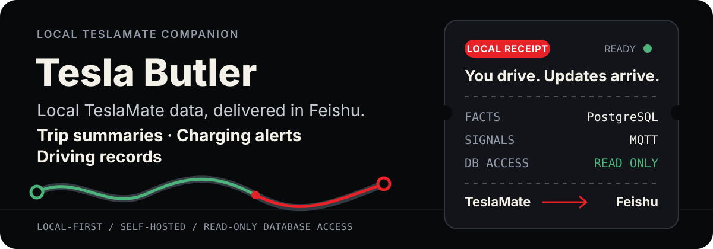

<p align="center">
  <a href="./README.md">简体中文</a> · <strong>English</strong>
</p>

<p align="center">
  
</p>

<p align="center">
  A locally hosted tool for individual Tesla owners. Raw vehicle data stays on your own computer; results arrive proactively through Feishu.
</p>

<p align="center">
  <a href="#local-installation-and-first-run">Get started</a> · <a href="infra/feishu/README.md">Connect Feishu</a> · <a href="#how-it-works">How it works</a> · <a href="LICENSE">MIT License</a>
</p>

> This is the English documentation for Tesla Butler (特斯拉小管家). The screenshots show the original Chinese interface. Chinese bot commands are kept below with English explanations; linked setup and maintenance guides are currently in Chinese.

## Real mobile screenshots

All five images below are actual Feishu screenshots from a phone, not mockups. The first four use the original user-provided PNGs; the charging screenshot has only its VIN row redacted. The source images have not been cropped or resized, and the product output has not been rewritten.

<table>
  <tr>
    <th align="center" width="50%">🧾 End-of-trip notification<br><sub>Cost, energy use, distance, and driving insights for each complete trip</sub></th>
    <th align="center" width="50%">📊 Weekly summary<br><sub>Distance, electricity costs, and gasoline-car cost comparisons</sub></th>
  </tr>
  <tr>
    <td align="center" valign="top" width="50%">
      
    </td>
    <td align="center" valign="top" width="50%">
      
    </td>
  </tr>
  <tr>
    <th align="center" width="50%">🧭 Bot menu<br><sub>Quick access to trips, vehicle status, weekly/monthly bills, and the default electricity rate</sub></th>
    <th align="center" width="50%">🚗 Vehicle overview<br><sub>Current battery level, estimated range, and this month's driving statistics</sub></th>
  </tr>
  <tr>
    <td align="center" valign="top" width="50%">
      
    </td>
    <td align="center" valign="top" width="50%">
      
    </td>
  </tr>
  <tr>
    <th align="center" colspan="2">⚡ Charging receipt recognition<br><sub>Extract costs and energy, then attempt to match a TeslaMate charging session</sub></th>
  </tr>
  <tr>
    <td align="center" valign="top" colspan="2">
      
    </td>
  </tr>
</table>

> These screenshots were captured during ongoing development. The current menu includes an equally sized “设置默认电价” (Set default electricity rate) entry. Monthly reports also show the reporting period, the number of TeslaMate driving records, and the actual pricing basis, and select the main route by cumulative distance. Older names and host labels in the screenshots come from earlier versions; the project is now called Tesla Butler (特斯拉小管家).

## What it does

- **Trip summaries**: turn complete trips recorded by TeslaMate into distance, estimated energy use, trip electricity costs, and gasoline-car costs for the same distance.
- **Charging alerts**: notify you when charging starts, when it approaches the configured limit, and when it ends. Time estimates come from the current TeslaMate session; slow charging is shown in hours and minutes rather than a hard-coded “15 minutes.”
- **Charging receipts and personal electricity rates**: view or change your default rate from the menu. Receipt images enter the local ledger after recognition and user confirmation. Once reliably matched to a charging session, their actual all-in unit price is gradually allocated to trips.
- **Vehicle overview**: see the latest collected battery level, range, and vehicle state, plus this month's driving distance and duration.
- **Weekly and monthly reports**: summarize distance, energy use, and trip electricity costs by calendar period. Monthly reports specify the date range, raw driving-record count, and pricing basis, and show the recurring route with the greatest cumulative distance.
- **Evidence-based driving insights**: use only the actual current trip and past trips on the same route. Insights are hidden when there are too few samples, unreliable sampling, or recently repeated templates; the bot does not substitute generic canned advice.

### How electricity costs are calculated

The system stores the default electricity rate separately from reliably matched charging receipts. It does not overwrite all historical costs with an average receipt price:

1. **Default rate**: setting it for the first time prices previously unpriced trips. Later changes apply only to new trips that start after the change.
2. **Actual receipt rate**: each confirmed receipt reliably matched to a TeslaMate charging session creates an energy batch with its actual all-in unit price.
3. **Gradual consumption**: trips consume that batch in chronological order, starting after the corresponding charging session ends. Once the batch is exhausted, pricing returns to the default rate effective at that time.
4. **No reliable match**: the receipt remains in the local ledger but is excluded from trip cost allocation, preventing its price from being applied to the wrong charging session.

By default, a complete image receipt is matched against charging sessions completed within the seven days before it was received, using both time and energy. Automatic matching occurs only when one candidate is sufficiently reliable. If several candidates are similarly plausible, the user selects one in the card. Two confirmed receipts cannot claim the same charging session.

### Complete a receipt when recognition is incomplete

- Image recognition returns a draft and clearly flags missing or unreliable fields. If OCR is unavailable, you can still create a draft with text. Drafts do not count toward cost statistics.
- Reply in Chinese with, for example, `充了30度` (“Charged 30 kWh”), `金额应该是24元` (“The amount should be CNY 24”), or `昨天充了30度，花了24元` (“Yesterday I charged 30 kWh for CNY 24”). Supported inputs include numeric amounts, energy, `YYYY-MM-DD HH:mm` timestamps, and 今天／昨天／前天 (“today” / “yesterday” / “the day before yesterday,” UTC+8). Bare numbers, questions, and default-rate commands are not treated as receipt corrections.
- Text updates apply only when the current conversation has exactly one unconfirmed draft. If there are several, confirm or dismiss the others first; the bot does not guess. After editing, confirm on the latest version of the card. Duplicate messages do not create duplicate records, and text cannot overwrite a confirmed receipt.
- Text updates clear previous cost breakdowns, inferred unit prices, and charging-session matches, while preserving directly recognized energy values that were not changed. Text drafts are not currently rematched automatically. Unmatched records are excluded from trip cost allocation.
- If multiple orders or unpaid items cannot be reliably distinguished in an image, the bot will not combine their fields. It asks for a single paid receipt instead. The actual amount paid and energy must still be supplied, pass validation, and be confirmed before the receipt enters the ledger.

> Compatibility note: receipts confirmed before automatic matching was introduced are not silently backfilled. They remain in the ledger, but only new receipts with reliable matches become energy batches priced at actual receipt rates.

### How monthly reports choose the main route

The monthly report no longer simply picks the most frequent route. It now:

1. Groups routes by endpoints, combining trips in both directions.
2. Keeps only routes traveled at least three times during the reporting period.
3. Selects the candidate with the greatest cumulative distance.
4. Uses trip count as a tiebreaker only when cumulative distances are equal.

This prevents frequent but very short parking-garage movements from outranking the route that accounts for most of the month's driving. The monthly gasoline-car comparison chart also reserves space for the largest amount so that the rightmost number is not automatically hidden on mobile.

### When a trip ends

The normal trip boundary follows this event sequence, rather than a fixed five-minute silence after parking:

```text
PostgreSQL records the end of a drive
        ↓
Driver's door opens → closes (preferred path)
        ↓
A new lock event occurs
        ↓
Wait about 45–60 seconds, aggregate, and send
```

- Automatic locking while driving does not end a trip.
- If driver's-door messages are missed, a new lock event within ten minutes of parking can serve as an alternative boundary. Resuming driving within the confirmation window cancels that boundary.
- A lock event alone cannot create or send a trip when no parked trip is awaiting completion.
- If you resume driving within 30 minutes of parking without locking, the drives continue to merge into the same user trip.
- If driving has not resumed 30 minutes after the database's parking timestamp, a timeout ends the trip. Other MQTT changes do not extend that timer.
- Starting a charging session is a hard trip boundary.
- Failed trip notifications remain pending and are marked as sent only after successful delivery, helping prevent loss or duplication after a restart.

## How it works

```text
Authorize Tesla locally
      ↓
TeslaMate
      ├── PostgreSQL: trip, GPS, time, energy, and charging facts
      └── MQTT: low-latency door-lock and charging-state boundary signals
                         ↓
                Local Worker
                ├── Trip sessions and idempotency
                ├── Power integration and cost calculation in CNY
                ├── Local receipt OCR with Apple Vision
                └── Feishu Card 2.0 and proactive notifications
```

PostgreSQL is the source of truth for trips, GPS, and energy use. MQTT only helps identify boundaries faster. It does not replace database facts and is not used to infer routes or costs.

## Privacy and security boundaries

- The project runs locally by default. It does not operate a public server or require a separate account system or shared backend.
- Enter your Tesla account, password, and MFA only on Tesla's official login page or in a local authorization tool. Tokens are passed only to your local TeslaMate instance.
- Individual owners currently use the Owner API token flow supported by TeslaMate. This is an unofficial API that may stop working after Tesla changes, and the token is not a fine-grained, read-only token.
- This project's own code only reads the TeslaMate PostgreSQL database. It does not send vehicle commands such as unlocking, starting, honking, or remote start.
- VINs, precise addresses, raw GPS data, tokens, secrets, Feishu message identifiers, and original receipt images must not be placed in Git, Markdown, or logs.
- Charging receipts are recognized locally with macOS Apple Vision by default. An optional external vision-model fallback is enabled only if the user explicitly configures it.
- Authorization does not provide historical data. TeslaMate records only new trips after authorization while the host is online and running; it cannot recover routes from before installation or from periods when the host was offline.

## Local installation and first run

The source code is public, and self-hosting on a Mac is currently supported. There is no one-command `npx` installer. An AI agent can help with the steps below; you must complete account authorization yourself.

**A complete deployment has three parts. Starting Docker alone will not deliver Feishu reports.**

| Docker: collect | Mac: process | Feishu: send and receive |
| :--- | :--- | :--- |
| TeslaMate, PostgreSQL, MQTT, Grafana | Node.js Worker, maps, Apple Vision OCR | Your own custom app bot |
| Record vehicle data and trips | Calculate electricity costs; generate cards and reports | Receive screenshots, respond to menu actions, and send proactive notifications |

### 1. Prepare the environment

- macOS 13+, Node.js 22+, Git, and Docker Desktop or a compatible container runtime.
- Google Chrome for rendering map images, and Xcode Command Line Tools for compiling local OCR. If needed, install the latter with `xcode-select --install`.
- A Feishu account with permission to create a custom app. Install the [official Feishu CLI](https://github.com/larksuite/cli/blob/main/README.zh.md):

```bash
npx @larksuite/cli@latest install
```

### 2. Get the code

```bash
git clone https://github.com/manwithshit/tesla-butler.git
cd tesla-butler
npm ci
```

### 3. Start the Docker collection services and authorize your vehicle

```bash
./scripts/init-teslamate-env.sh
docker compose --env-file infra/teslamate/.env \
  -f infra/teslamate/compose.yaml up -d
```

Follow the [TeslaMate local stack guide](infra/teslamate/README.md) to authorize your vehicle. Handle your account, MFA, and tokens only on Tesla's official pages or in a local authorization tool. Do not paste them into chats, issues, or logs.

### 4. Connect your own Feishu bot

Follow the [Feishu connection guide](infra/feishu/README.md) through this sequence:

**Create a custom app and enable its bot → restrict availability to yourself → bind the app locally → enable permissions and persistent connections → publish the app configuration → verify sending and receiving.**

This is not a group-chat webhook bot. Each person deploying the project uses their own app credentials. The local `lark-cli` manages those credentials; they are not stored in the project. If the admin console requires an active persistent connection before saving subscriptions, start the Worker first as described in the guide, then finish configuring subscriptions.

### 5. Start the local assistant and verify the first exchange

```bash
npm run worker
```

In Feishu, open your own “特斯拉小管家” (Tesla Butler) bot and send **菜单** (“menu”). Confirm that it replies with a card, then click “车辆概览” (Vehicle overview). The Worker maintains persistent connections for both messages and button events; no public server or callback domain is needed. Run only one Worker instance per bot.

Having no trips at first is normal: TeslaMate does not recover routes from before installation. Set your default electricity rate, keep the collection services and Worker online, and use subsequent new trips to verify automatic notifications.

<details>
<summary>Upgrading an existing deployment and using custom CLI paths</summary>

The project's display name is Tesla Butler (特斯拉小管家), and the repository is `tesla-butler`. To preserve compatibility with existing data, the Docker Compose project name, LaunchAgent labels, and default Feishu profile still use `tesla-saving-ticket`. Do not create new data volumes or move a running deployment's working directory just to rename it. The `private: true` field in `package.json` prevents accidental npm publishing; it does not mean the GitHub repository is private.

The program first uses explicit `LARK_CLI` / `DOCKER_CLI` / `NODE_CLI` settings, then searches PATH. For lark-cli and Docker, it also checks user installation directories and common Apple Silicon and Intel paths. By default, Node reuses the executable that started the Worker. Override these environment variables for custom installations.

Maintenance records: [Reliability trial](docs/engineering/260906_M1可靠性试运行.md) · [Map recovery](docs/plans/2026-09-07-map-card-recovery.md) · [Trip-boundary recovery](docs/plans/2026-09-16-trip-boundary-recovery.md). These document existing deployments; they do not replace acceptance checks for your own installation.

</details>

## Common commands and validation

```bash
npm run status              # Check local connections and data status
npm test                    # Automated tests without accessing real services
npm run test:live           # Read-only checks of local TeslaMate data
npm run test:charging-live  # Read-only checks of the latest charging session
npm run test:trip-live      # Read-only checks of trip aggregation
npm run test:trip-session-live
npm run test:trip-insights-live
npm run test:pricing-live   # Read-only checks of default/receipt rate allocation
```

The `*:live` commands read real local data on the current host. Passing them does not establish acceptance of actual vehicle behavior, Feishu delivery, or mobile rendering. Do not run them on the wrong host, before clarifying the responsibilities of a two-host setup, or when service state is unknown.

Stop TeslaMate without deleting its data volumes:

```bash
docker compose --env-file infra/teslamate/.env \
  -f infra/teslamate/compose.yaml stop
```

Do not use `down -v` unless you explicitly intend to delete all vehicle data.

## Known limitations

- The source code is public, and the tool currently targets self-hosting on a Mac. There is no one-command installer, and Apple Vision recognition cannot run directly in a standard Linux Docker container.
- Trip electricity costs are estimates derived from integrating power samples and applying user electricity rates. Gaps in sampling reduce reliability.
- Gasoline-car comparisons cover energy costs only, excluding vehicle purchase, depreciation, insurance, parking, and time costs. Fuel-consumption and fuel-price sources and their effective dates must be retained.
- Apple Vision has been validated on a limited set of receipt layouts. Unfamiliar layouts may require the optional fallback or an explicit failure response.
- Receipts affect trip electricity costs only after confirmation and reliable matching to a TeslaMate charging session. Older confirmed but unmatched receipts do not automatically rewrite historical costs.
- The lock-event boundary has automated and live-safe validation. The full real-vehicle sequence of `park → open door → close door → new lock event` still needs separate acceptance against the next actual trip.
- Historical charging statistics and historical routes are different datasets. Access to charging statistics does not imply that past trip routes can be retrieved or restored.

## Maintenance documentation

The following documents are in Chinese:

- [Trip-session lock-boundary design](docs/plans/2026-08-26-trip-session-lock-boundary-design.md)
- [Matching charging receipts to TeslaMate sessions](docs/plans/2026-08-30-receipt-charging-match.md)
- [Default electricity rates and actual receipt cost allocation: design](docs/plans/2026-08-31-electricity-pricing-ledger-design.md)
- [Default electricity rates and actual receipt cost allocation: implementation plan](docs/plans/2026-08-31-electricity-pricing-ledger-implementation.md)
- [M1 long-term maintenance handoff](docs/engineering/260825_M1长期维护交接.md)
- [M1 final migration acceptance](docs/engineering/260825_M1最终切换验收.md)
- [Installation, authorization, and local OCR decisions](docs/engineering/260825_安装授权与本地OCR_决策交接.md)
- [Tesla data access and open-source collection options](docs/research/260823_开源采集方案选型.md)
- [TeslaMate local stack](infra/teslamate/README.md)
- [Feishu bot configuration](infra/feishu/README.md)

## License and contributions

This project is licensed under the [MIT License](LICENSE). You may use, modify, distribute, and use it commercially, provided that the original copyright and license notices are retained when distributing it. The software is provided as is, without warranty; the full license governs.

Pull requests for NAS, Linux, and other platforms are welcome. Please include setup instructions, the environment tested, and known limitations. This invitation does not imply that those platforms are already supported or verified, and contributing changes back is not required by the license.

Third-party dependencies and components, including TeslaMate, remain subject to their respective licenses. This license does not grant rights to third-party brands or trademarks such as Tesla or Feishu.
