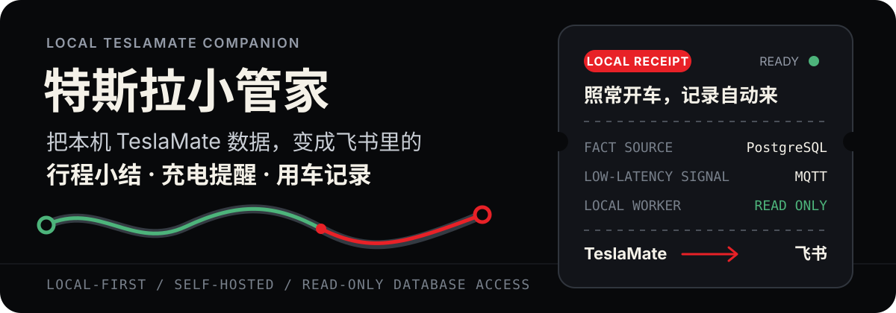
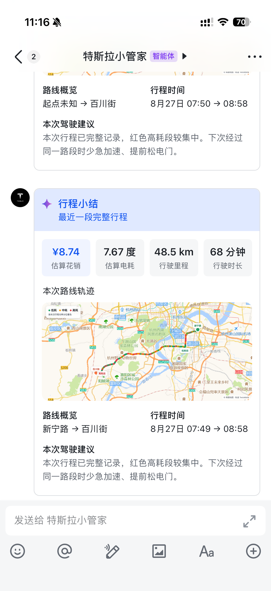
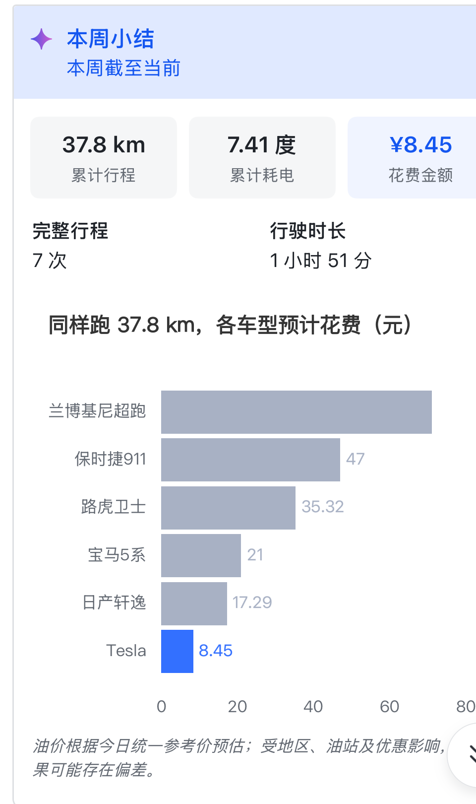
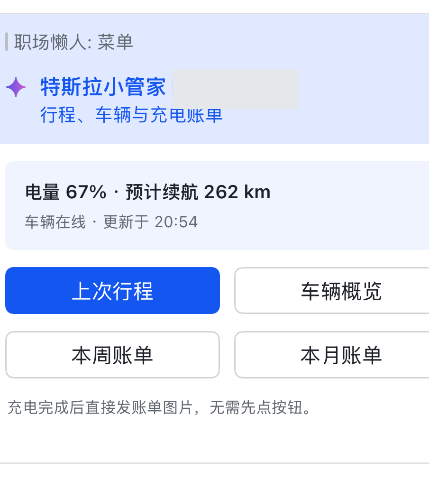
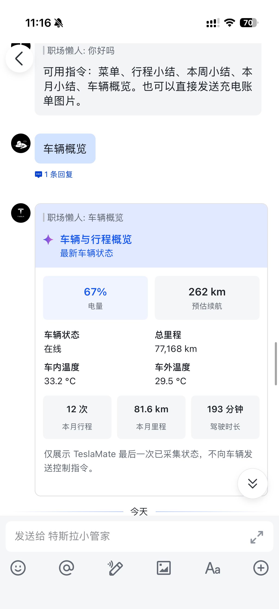
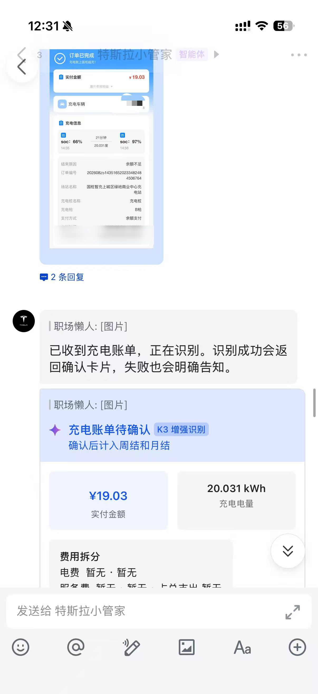

<p align="center">
  
</p>

<p align="center">
  面向个人 Tesla 车主的本地自托管工具。原始车辆数据留在自己的电脑上，结果通过飞书主动到达。
</p>

> 当前运行边界：生产采集与飞书 Worker 已迁移到 M1。M5 只保留为维护环境，TeslaMate、PostgreSQL、Mosquitto、Grafana 和 Worker 均应保持停止。

## 真实手机截图

下面五张均为手机里的真实飞书截图，不是概念图。前四张直接使用用户提供的原始 PNG；充电截图仅对 VIN 行做必要遮挡。所有图片均未裁剪或缩放，产品结果没有改写。

<table>
  <tr>
    <th align="center" width="50%">🧾 行程结束推送<br><sub>每段完整行程的费用、能耗、里程与驾驶建议</sub></th>
    <th align="center" width="50%">📊 本周小结推送<br><sub>周期里程、电费与油车费用对比</sub></th>
  </tr>
  <tr>
    <td align="center" valign="top" width="50%">
      
    </td>
    <td align="center" valign="top" width="50%">
      
    </td>
  </tr>
  <tr>
    <th align="center" width="50%">🧭 功能菜单<br><sub>快速查询行程、车辆、周/月账单与默认电价</sub></th>
    <th align="center" width="50%">🚗 车辆概览<br><sub>当前电量、预计续航与本月行驶统计</sub></th>
  </tr>
  <tr>
    <td align="center" valign="top" width="50%">
      
    </td>
    <td align="center" valign="top" width="50%">
      
    </td>
  </tr>
  <tr>
    <th align="center" colspan="2">⚡ 充电账单识别<br><sub>识别费用与电量，并尝试关联 TeslaMate 充电会话</sub></th>
  </tr>
  <tr>
    <td align="center" valign="top" colspan="2">
      
    </td>
  </tr>
</table>

> 截图记录于持续迭代阶段。当前菜单已新增等宽的“设置默认电价”入口；月报也会显示统计周期、TeslaMate 驾驶记录数、真实计价依据，并按累计里程选择主跑路线。截图中的旧运行主机标签不代表当前生产边界。

## 它能做什么

- **行程小结**：把 TeslaMate 记录的完整行程换算成里程、估算耗电、行程电费和同里程油车费用对比。
- **充电提醒**：开始充电、即将达到设置上限、充电结束时主动提醒；预计时间来自 TeslaMate 当前会话，慢充会直接显示为小时和分钟，不使用写死的“15 分钟”。
- **充电账单与个人电价**：菜单可查看或修改默认电价；账单图片经识别和用户确认后进入本地账本，可靠关联充电会话后会按当次真实综合单价逐步分摊。
- **车辆概览**：集中显示最近采集的电量、续航、车辆状态，以及本月里程与时长。
- **周结与月结**：按自然周期汇总累计里程、耗电和行程电费；月报明确统计区间、原始驾驶记录数和计价口径，并展示累计贡献里程最高的重复路线。
- **事实型驾驶提示**：只使用本次真实行程和同路线历史。样本不足、采样不可靠或近期模板重复时直接隐藏，不展示固定的泛化建议。

### 电费如何计算


系统把“日常默认电价”和“已可靠关联的充电账单”分开保存，不用账单平均价粗暴改写所有历史：

1. **默认电价**：首次设置会补算此前尚未定价的行程；以后修改只对修改后开始的新行程生效。
2. **账单实际价**：每张已确认且可靠关联 TeslaMate 充电会话的账单，都会形成一批带真实综合单价的电量。
3. **逐步消耗**：这批电量从对应充电结束后开始，按行程顺序逐步消耗；用完后再回到当时生效的默认电价。
4. **无法可靠关联**：账单仍保存在本地账本，但不会进入行程电费分摊，避免把价格套到错误的充电会话。

账单默认在收到前 7 天的已完成充电中寻找候选，并同时参考时间与电量。只有一个候选足够可靠时才自动关联；出现多个相近候选时由用户在卡片中选择。同一充电会话不能被两张已确认账单重复占用。

> 兼容说明：自动关联能力上线前已经确认的旧账单不会静默回填。它们仍保留在账本中，但只有完成可靠关联的新账单才会成为实际电价批次。

### 月报主跑路线如何选择

月报不会再简单选择“出现次数最多”的路线。当前规则是：

1. 按起终点聚合同向和反向路线；
2. 只保留周期内至少出现 3 次的路线；
3. 在这些候选中，选择累计行驶距离最高的一条；
4. 累计距离相同时，才使用出现次数作为次级排序。

这样可以避免高频但极短的地库挪车压过真正贡献大部分月度里程的路线。月报油车对比图也会为最高金额预留固定空间，避免手机端把最右侧数字自动隐藏。

### 行程何时算结束

正常边界不是“停车后固定静默 5 分钟”，而是以下事件序列：

```text
PostgreSQL 记录行程结束
        ↓
驾驶门打开 → 关闭（优先路径）
        ↓
出现新的落锁
        ↓
等待约 45–60 秒聚合并推送
```

- 行驶中的自动落锁不会结束行程。
- 如果驾驶门消息漏失，停车后 10 分钟内的新落锁可作为并行边界；确认窗口内重新驾驶会撤销该边界。
- 没有正在等待结束的停车行程时，单独落锁不会创建或推送行程。
- 停车后未落锁且 30 分钟内继续驾驶，会继续合并到同一用户行程。
- 从数据库停车时间起满 30 分钟仍未继续驾驶，由超时边界兜底结束；其他 MQTT 变化不会延长计时。
- 充电开始是强行程边界。
- 行程发送失败会保留待发送状态；成功后才确认，避免重启造成丢失或重复。

## 它怎么工作

```text
Tesla 本机授权
      ↓
TeslaMate
      ├── PostgreSQL：行程、GPS、时间、能耗与充电事实
      └── MQTT：门锁与充电状态的低延迟边界信号
                         ↓
                本地 Worker
                ├── 行程会话与幂等
                ├── 能耗积分与人民币换算
                ├── Apple Vision 本地账单 OCR
                └── 飞书 Card 2.0 与主动推送
```

PostgreSQL 是行程、GPS 和能耗的事实来源。MQTT 只帮助更快识别边界，不能替代数据库事实，也不用于推断路线或费用。

## 隐私与安全边界

- 项目默认本地运行，不运营公共服务器，也不要求账号体系或共享后端。
- Tesla 账号、密码和 MFA 只输入 Tesla 官方登录页或本机授权工具；Token 只交给本机 TeslaMate。
- 个人车主当前使用 TeslaMate 支持的 Owner API Token 路径。它是非官方 API，可能因 Tesla 变更而失效，也不是细粒度“只读 Token”。
- 本项目自研代码只读 TeslaMate PostgreSQL，不发送解锁、启动、鸣笛、远程启动等车辆命令。
- VIN、精确地址、原始 GPS、Token、Secret、飞书消息标识和原始账单图片不得进入 Git、Markdown 或日志。
- 充电账单默认由 macOS Apple Vision 在本机识别；只有用户主动配置外部视觉模型时才启用可选兜底。
- 授权不等于已经有历史数据。TeslaMate 只能持续记录授权后、设备在线运行期间的新行程，不能补录安装前或离线期间的历史轨迹。

## 本地安装与首次运行

> 可靠性修复包括：门锁信号先落盘、查询失败重试与反馈、后台任务防积压、账单上海时区统一、菜单查询超时降级，以及地图缓存恢复。详见 [M1 可靠性试运行记录](docs/engineering/260906_M1可靠性试运行.md) 和 [9 月 7 日发布验收](docs/engineering/2026-09-07-release-verification.md)。

> 行程卡底图暂不可用时，会在轨迹图片下方显示灰色小字，真实轨迹仍保留。新版本发送的降级行程卡五分钟后自动尝试恢复，最多三轮；成功只更新原卡片的地图，不重复推送、不重算费用。任务随本机状态保存，重启后继续；旧版本未保存消息引用的历史卡片不自动追溯。详见 [底图恢复设计与验收](docs/plans/2026-09-07-map-card-recovery.md)。

当前仓库是私有的 Mac 原型，尚未发布可用的 `npx` 一键安装器。仓库成员可按下面的维护路径安装；普通车主暂不应把它当作开箱即用的软件。

### 1. 准备环境

- macOS 13 或更高版本
- Node.js 22 或更高版本
- Docker Desktop 或兼容的本地容器运行时
- TeslaMate 当前支持的本机授权工具
- 已完成最小权限配置的飞书机器人

### 2. 获取代码与安装依赖

```bash
gh repo clone manwithshit/tesla-saving-ticket
cd tesla-saving-ticket
npm ci
```

### 3. 初始化并启动 TeslaMate 本地栈

```bash
./scripts/init-teslamate-env.sh
docker compose --env-file infra/teslamate/.env \
  -f infra/teslamate/compose.yaml up -d
```

只在 Tesla 官方登录页或本机授权工具中完成授权。不要把账号、MFA 或 Token 粘贴到聊天、Issue、Markdown 或命令日志中。完整说明见 [TeslaMate 本地运行栈](infra/teslamate/README.md)。

### 4. 配置飞书并启动 Worker

按 [飞书机器人配置](infra/feishu/README.md) 完成最小权限、事件与卡片回调配置，并确认同一套账号只有一个 Worker 在运行：

```bash
npm run worker
```

首次打开菜单且尚未设置默认电价时，机器人会额外发送一次默认电价输入卡；以后可以随时从菜单重新进入并修改。首次授权后界面可能仍没有行程，这是正常的冷启动状态。只有 TeslaMate、PostgreSQL 和 Worker 在车辆行驶时持续运行且联网，之后的新数据才会累积。

## 常用命令和验证

```bash
npm run status              # 查看本地连接与数据状态
npm test                    # 不接触真实服务的自动化测试
npm run test:live           # 只读检查本机 TeslaMate 数据
npm run test:charging-live  # 只读检查最新充电会话
npm run test:trip-live      # 只读检查行程聚合
npm run test:trip-session-live
npm run test:trip-insights-live
npm run test:pricing-live   # 只读检查默认价与账单价分摊
```

`*:live` 会读取当前主机上的真实本地数据，不能把通过结果等同于真实车辆、飞书到达或移动端渲染已经验收。不要在错误主机、未确认双机边界或服务状态不明时运行。

停止 TeslaMate 时不要删除数据卷：

```bash
docker compose --env-file infra/teslamate/.env \
  -f infra/teslamate/compose.yaml stop
```

除非明确要删除全部车辆数据，否则不要使用 `down -v`。

## 已知限制

- 当前为私有、Mac-only 原型；一键安装器、多平台支持和公开分发尚未完成。
- 行程电费来自功率采样积分与用户电价换算，是估算值；采样缺口会降低可靠性。
- 油车费用只比较能源费，不包含购车、折旧、保险、停车和时间成本，并必须保留油耗、油价来源及口径日期。
- Apple Vision 已验证的账单版式仍有限；未知版式可能需要可选兜底或明确失败反馈。
- 账单只有在确认且可靠关联 TeslaMate 充电会话后才会影响行程电费；旧版已确认但未关联的账单不会自动改写历史费用。
- 门锁边界已有自动化和 live-safe 验证；真实车辆的完整 `停车 → 开门 → 关门 → 新落锁` 顺序仍应与下一次实际行程分别验收。
- 历史充电统计与历史路线是两类数据。能看到充电统计，不代表能取得或补回历史行程轨迹。

## 维护文档

- [行程会话落锁边界设计](docs/plans/2026-08-26-trip-session-lock-boundary-design.md)
- [充电账单与 TeslaMate 会话关联方案](docs/plans/2026-08-30-receipt-charging-match.md)
- [默认电价与实际账单分摊设计](docs/plans/2026-08-31-electricity-pricing-ledger-design.md)
- [默认电价与实际账单分摊实施计划](docs/plans/2026-08-31-electricity-pricing-ledger-implementation.md)
- [M1 长期维护交接](docs/engineering/260825_M1长期维护交接.md)
- [M1 最终切换验收](docs/engineering/260825_M1最终切换验收.md)
- [安装授权与本地 OCR 决策](docs/engineering/260825_安装授权与本地OCR_决策交接.md)
- [Tesla 数据获取与开源采集方案](docs/research/260823_开源采集方案选型.md)
- [TeslaMate 本地运行栈](infra/teslamate/README.md)
- [飞书机器人配置](infra/feishu/README.md)
